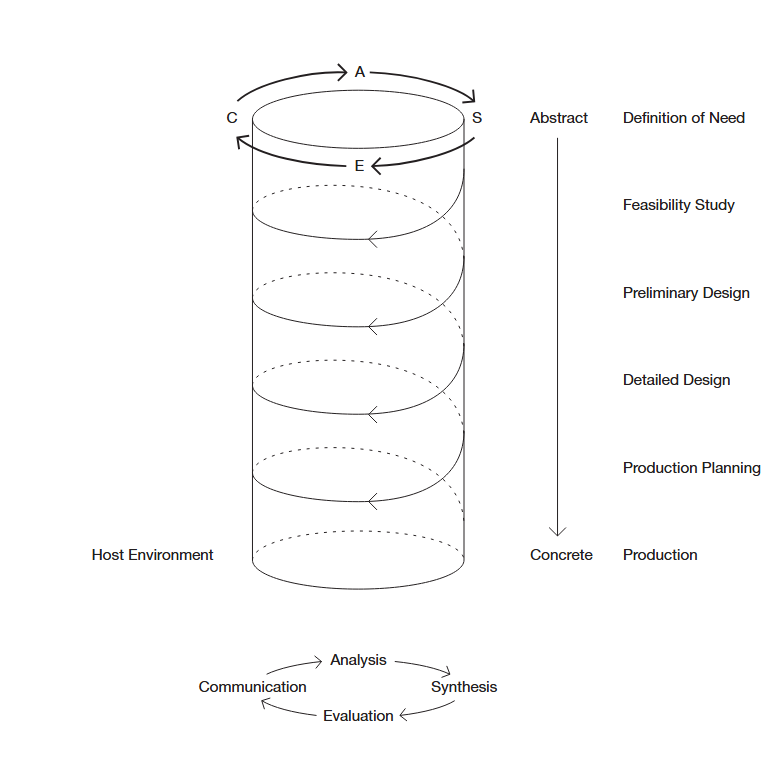

date-created:: [[2026-07-14]]
date-updated::
type:: #literature-memo
alias::
tags::

- #reference {Better BibTex citation quick copy} [@wickhamTidyData2014] {[원문](zotero://select/library/items/52BLM44J)}
- #comment
	- [[2026-07-14]] 데이터를 이해하기 위한 준비단계로서 데이터를 정제하는 혹은 간소화하는 단계를 설명한다.
		- Understanding data through visual form이 가장 큰 목적이다. 이 목적에 부합하는 단계로서 데이터 이해라는 세부 단계가 필요하다. 따라서 데이터 이해는 선순환을 이루는 과정이고 이 과정이 반복될수록 데이터를 이해하는 사람이 늘어나거나, 데이터와 관계를 맺는 이해 당사자의 수가 늘어나게 된다.
		- 
		- [pdf](zotero://open-pdf/library/items/Z59CMJVV?page=121&annotation=XS9S3JV9) ([Dubberly, 2005, p. 121](zotero://select/library/items/ANQ3WPK7))
		- 가시화 전문가는 분석 수행 후 가시화라는 방법으로 소통(communication)한다. 동일한 순환이 가시화 소비자에게도 일어나는데 대신 소비자는 원시자료를 분석하는 대신 가시화 전문가가 제시하는 가시화를 분석한다. 차트가 제시하는 기호와 시각적 실마리를 종합해 평가한 후 스스로와 혹은 다른 소비자와 소통한다. 즉 가시화 전문가가 원시 자료를 분석하는 방향이 가시화 소비자의 소통을 한정한다.
- #excerpt
	- {Better BibTex citation quick copy} {note}
		- {excerpt}
- log
	- [[2026-07-14]] memo created.