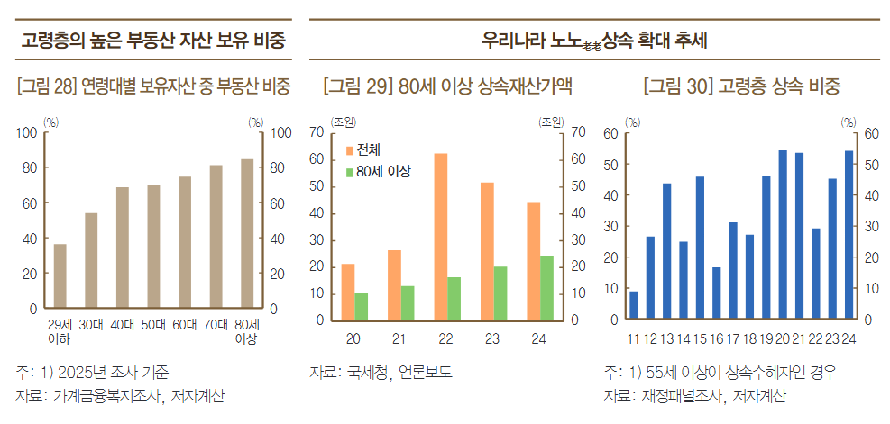

date-created:: [[2026-07-15]]
date-updated::
type:: #literature-memo
alias::
tags::

- #reference {Better BibTex citation quick copy} [@iUriGyeongjeGagye2026] {[원문](zotero://select/library/items/PUZPU4KA)}
- #comment
	- “베이지안 VAR 모형 추정 방법” ([이 et al., 2026, p. 17](zotero://select/library/items/PUZPU4KA)) ([pdf](zotero://open-pdf/library/items/E429U2NB?page=17&annotation=JCCBE2BR))이 뭔지 더 공부해봐라.
- #excerpt
	- {Better BibTex citation quick copy} {note}
		- 부의 편중이란 생산성 향상을 위한 자금이 줄어든다는 말이다.
			- “국가패널 데이터120개국를 활용한 동태패널 분석 결과8)에 따르면 상위 10%의 자산점유율이 1%p 상승할 경우 2년 후 총요소생산성TFP이 0.16% 하락하는 것으로 나타났다. 우리나라의 경 우 상위 10% 순자산 점유율이 2022년 43.0%에서 2025년 46.1%로 상승9)하였는데, 위 분석 결과를 감안할 때 이는 자산 격차 확대가 우리 경제의 성장과 생산성 향상에 작지 않은 제약 요 인이 될 수 있음을 시사한다.” ([이 et al., 2026, p. 10](zotero://select/library/items/PUZPU4KA)) ([pdf](zotero://open-pdf/library/items/E429U2NB?page=10&annotation=NU7PJDHN))  소득 분배의 편향성과 국가 생산성(TFP)은 음의 상관관계에 있다.
		- 노령층의 부를 노령층이 다시 상속받는 고령자간상속이 증가하면서 노후 생활에 자산이 종속되는 현상이 지속되고 있다. 이는 전체 사회의 혁신적 경제 활동을 제약할 수 있다.
			- “특히 우리나라의 경우 부동산 중심의 자산 보유로 생산적인 부문에 자원이 활용되지 못한다는 점 이 지속적으로 지적되고 있는데, 고령화로 인한 자산 잠김현상wealth lock-in은 이러한 자원 비효율 문제를 더욱 심화시킬 것으로 예상된다. 자본이 혁신기업이나 신기술 분야로 유입되기보다 비생 산적 자산이나 고령층에 장기간 묶일 경우 자원배분의 효율성이 저하되고, 신규 기업의 진입과 혁신 활동이 제약될 수 있다. 우리나라는 보유 자산 중 부동산 비중이 매우 높은데 고령층으로 갈수록 이 같은 경향이 강화된다. 고령 가계가 주로 보유하고 있는 부동산은 거주 목적의 실물자 산이라는 특성상 거래·이전이 상대적으로 제한적이어서, 세대 간 자산 이전과 순환이 원활하게 이루어지지 않는 경향이 있다. 실제 여러 상속 관련 통계들도 고령 세대의 자산이 자식 세대로 이전되는 시기가 최근 들어 더욱 늦춰지고 있음老老 상속을 보여준다.” ([이 et al., 2026, p. 10](zotero://select/library/items/PUZPU4KA)) ([pdf](zotero://open-pdf/library/items/E429U2NB?page=10&annotation=8VBEZBTZ))
			- 
			- ([pdf](zotero://open-pdf/library/items/E429U2NB?page=11&annotation=33H4ZFNW))  ([이 et al., 2026, p. 11](zotero://select/library/items/PUZPU4KA))
		- 자산 편중은 경제적 충격이 발생할 경우 사회 전반이 내구력과 복원력을 저하시킨다.
			- “고소득·고자산 가계에 대한 의존도를 높이고 청 년층의 재무여건을 악화시켜 경제적 충격에 대한 취약성을 확대” ([이 et al., 2026, p. 13](zotero://select/library/items/PUZPU4KA)) ([pdf](zotero://open-pdf/library/items/E429U2NB?page=13&annotation=C5ZAXGC7))
		- 분배는 사치가 아니라 사회 전반의 생산성 유지를 위한 전략임을 인정해야 한다.
			- “경제 전반의 생산성 저하와 소비 위축을 초래해 성장 잠재력을 잠식할 우려가 크다.” ([이 et al., 2026, p. 15](zotero://select/library/items/PUZPU4KA)) ([pdf](zotero://open-pdf/library/items/E429U2NB?page=15&annotation=8KESYRSD))
		- 선심성 현금살포가 구조적 문제를 해결할 수는 없다.
			- “누적된 자산 격차와 산업 간 구조화된 생산성 차이에 기인한 양극화 상황에서 일부 취약층에 대한 생계비·고용 지원만으로는 근원적 문제를 해결하기 힘들다.” ([이 et al., 2026, p. 15](zotero://select/library/items/PUZPU4KA)) ([pdf](zotero://open-pdf/library/items/E429U2NB?page=15&annotation=6RD4F6P2))
		- 현금이 아니라 자산 생성 기회를 줘야 한다. “생산적 자산 형성 기회를 확대” ([이 et al., 2026, p. 15](zotero://select/library/items/PUZPU4KA)) ([pdf](zotero://open-pdf/library/items/E429U2NB?page=15&annotation=DDNW3ITE))
		- “근로소득을 통한 자산 형성 경로가 약화되지 않도록 제도를 점검해 갈 필요가 있다” ([이 et al., 2026, p. 15](zotero://select/library/items/PUZPU4KA)) ([pdf](zotero://open-pdf/library/items/E429U2NB?page=15&annotation=WQUA6ELJ))
		- “성장 동력을 다변화” ([이 et al., 2026, p. 16](zotero://select/library/items/PUZPU4KA)) ([pdf](zotero://open-pdf/library/items/E429U2NB?page=16&annotation=WLIBWAYF))로 성장의 과실을 다양한 산업군과 연령대가 공유할 수 있도록 해야 한다.
		-
- log
	- [[2026-07-15]] memo created.