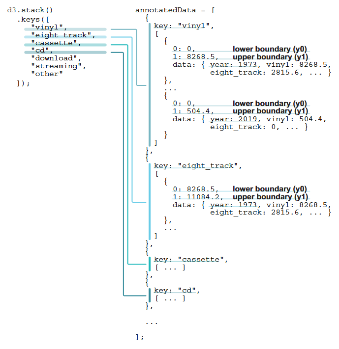

date-created:: [[2026-08-13]]
date-updated:: [[2026-08-13]]
alias::
tags:: [[obsidianized]] 
ai-sourced:: 
division::
stack::
type::
public:: true

- ## Summary
	-
- ## Steps
	- 
	- “Figure 5.13 Annotated dataset returned by the stack layout generator” ([Meeks, 2024, p. 170](zotero://select/library/items/VHTGXJRT)) ([pdf](zotero://open-pdf/library/items/FGBNWKIT?page=196&annotation=R98H6BVS))
	- Streamgraph의 annotated data의 구조가 좀 어렵다. 원문은 위와 같다. 배열의 구조를 설명하면 아래와 같다.
		- 2차원으로 중첩된 다차원 배열이다.
			- 1차원은 계열의 집합, 즉 키(key)값으로 지정한 계열의 숫자와 동일한 개수의 원소를 가진다.
				- 여기서는 vinyl, eight track, cassette, cd, download, streaming, other와 대응하므로 1차원 배열의 길이는 7이다.
			- 2차원은 해당 계열의 연도별 데이터 포인트이다. 47년 동안의 기록이므로 길이가 47인 배열이다.
				- 각 배열은 아래값을 가진다.
					- 해당 계열이 해당 연도에서 차지하는 막대의 경계값.
					- [하단 경계 수치값, 상단 경계 수치값]
					- `data`라는 이름의 객체에 해당 연도의 원본 데이터를 모두 저장한다.
		- 데이터를 각 연도별로 저장하지 않고 계열 아래 연도별로 데이터를 저장하는 이유는?
			- d3가 계열을 먼저 그리는 방식을 취하기 때문이다.
			- 실제로는 각 계열을 하나씩 그리는 방식을 취한다.
			- 스트림그래프는 d3.area()를 사용해 하나의 연속된 면을 그린다. 따라서 특정 계열을 먼저 그려야 한다. 이를 위해 annotated data의 1차 배열은 연도가 아닌 계열이어야 한다.
- ## Troubleshooting
	-
- ## log
	- [[2026-08-13]] Page created.
- ### References
	- “Area Graph” ([Harris, 1999, p. 10](zotero://select/library/items/B2BE79A2)) ([pdf](zotero://open-pdf/library/items/68AUMRF3?page=11&annotation=WYIMKGH3))
	- “Cosmograph” ([Harris, 1999, p. 112](zotero://select/library/items/B2BE79A2)) ([pdf](zotero://open-pdf/library/items/68AUMRF3?page=113&annotation=YXSEE6B9))