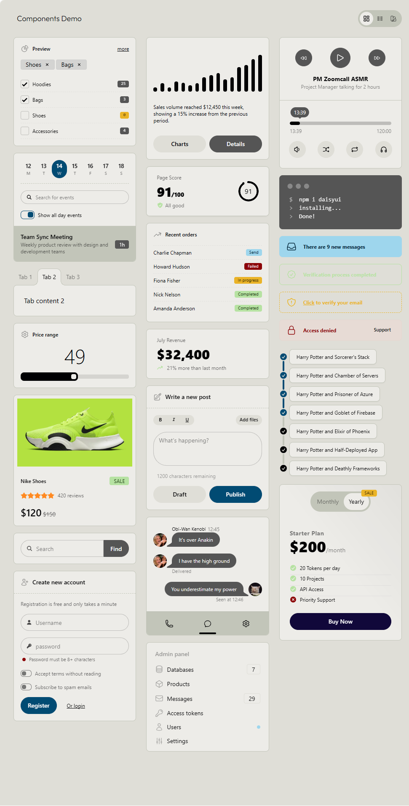
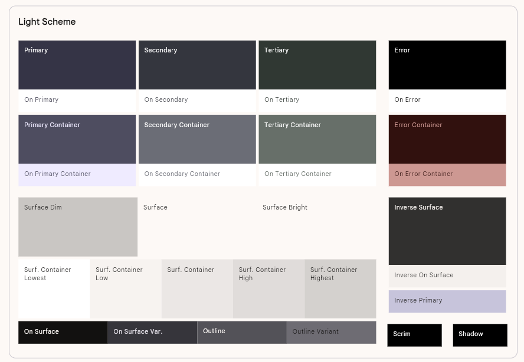
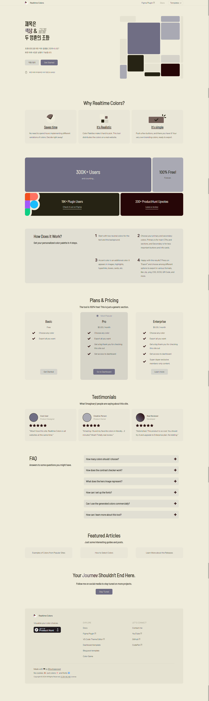

date-created:: [[2026-07-03]]
date-updated:: [[2026-07-03]]
alias::
tags::
ai-sourced:: 
division::
stack::
type::
public:: true

- ## Summary
	- 아래와 테마를 적용하면 tailwind CSS의 색상값도 변경된다. 대상은 아래와 같다.
		- `primary` 기준
			- 배경 및 텍스트 (Backgrounds & Typography)
				- 배경색 `bg-primary`
				- 글자색: `text-primary`
				- 장식선 색상 (밑줄 등): `decoration-primary`
			- 테두리 및 윤곽선 (Borders & Outlines)
				- 테두리 색상: `border-primary`
				- 윤곽선 색상: `outline-primary`
				- 분할선 색상 (자식 요소 사이): `divide-primary`
				- 가로/세로 규칙선 색상: `hr-primary` (v4 표준 또는 테두리 연동)
			- 그래픽 및 SVG (SVG & Effects)
				- SVG 내부 채우기: fill-primary
				- SVG 선 색상: stroke-primary
				- 그림자 색상: shadow-primary
				- 링 효과 색상: ring-primary
			- 폼 요소 및 기타 (Forms & Interactive)
				- 체크박스/라디오 강조색: accent-primary
				- 입력창 캐럿(커서) 색상: caret-primary
	- [[DaisyUI]]에서 [최신 배색](https://daisyui.com/theme-generator/?lang=ko#theme=eJx9k-1urCAQhm-FuGnSk1SCfC32bhDGs6auGtD0K733Ip71YHX7k5lnZt6Xgc-s01fInrMOXv2gB3C51e4le8ry3GnbTD730IIZexcggqlwcE2zdQOtDSn6I171b7Fg5X3zAfd6xdytU5qoemdhpgsshrcYsjCMlxmLp65v_Cy_CCfTt73LvblAdLT6WOKV9pAXhIRM_9KayyMtMH9ABBPCUcH4n58sTVmB2cLKQ5YlLAsGFlYFVuAwc8ebvhuhG9capW5aFCol5nxT0sE0Ot0G-sQ1Lznf55KOJ7BgQCVM09X9OooXcRBjiAalxXljxk_GgPcHcCFZCr5q1zXd3xUUBMsZLXiJ1BkrsaHBubjzf2yJxczSkiJGMd_ezyx2fz98KSFSIhqWQXl5IPvXspIe6N9VhGVFG4ogJTHh552NuyVMIs7weetmcM1Vu_f_itj9NXsIre1Cn4QRIKskq4PFZb_UUMHUfshOGWO3VyVQOT9Eejju17ezjE0RW9nSzr_PQq2nNsRq3Xp4ygYHNTgf_93z6Cb4-gYyyEIU)을 확인하라.
		- newspaper colorsafe 최종 확정이다.
		  collapsed:: true
			- ```css
			  
			  @plugin "daisyui/theme" {
			    name: "newspaper colorbsafe";
			    default: true;
			    prefersdark: false;
			    color-scheme: "light";
			    --color-base-100: #edece8;
			    --color-base-200: #dfded7;
			    --color-base-300: #c2c5b9;
			    --color-base-content: #000002;
			    --color-primary: #004b73;
			    --color-primary-content: #ffffff;
			    --color-secondary: #434f63;
			    --color-secondary-content: #ffffff;
			    --color-accent: #11083a;
			    --color-accent-content: #ffffff;
			    --color-neutral: #555555;
			    --color-neutral-content: #ffffff;
			    --color-info: #9ed6ed;
			    --color-info-content: #002336;
			    --color-success: #b6e2a2;
			    --color-success-content: #153308;
			    --color-warning: #eab308;
			    --color-warning-content: #2e1f00;
			    --color-error: #8b0000;
			    --color-error-content: #ffffff;
			    --radius-selector: 0.25rem;
			    --radius-field: 2rem;
			    --radius-box: 0.5rem;
			    --size-selector: 0.25rem;
			    --size-field: 0.25rem;
			    --border: 1px;
			    --depth: 0;
			    --noise: 0;
			  }
			  
			  ```
			- _1783409942008_0.png){:height 1516, :width 810}
			- _1783409934867_0.png)
		- newspaper lofi
		- newspaper
		  collapsed:: true
			- [링크](https://daisyui.com/theme-generator/?lang=ko#theme=eJyFU_1ugyAQfxXj0mRL1gugiOxtUM9pRsGAzb6ydx-jpmXVreEv7vd1d-hnbtQB86fc4Kuf1IQuf8xbq63b-3bACOnxeZhDeb8_AY3yuKeEBMi-6Ha4lzUIussIEJZRVoBgD9d0Ful3PcG2a67BIvGqS6hl9KLiL7PWmhnNfNZQCaJkUUTKDdHkxoNy7z8NCFJhzddY4nnXV-GUCcdjQLvFQdVKNsUWuu6LA-exrUJmlFIgMm1Lte2SyCoSzgr6tymDx9kpfQ4rCMg6hgmeUVJD9bBmJ46D1_cVg7AvCuHxZJDvUsVoent5lQro6VVKkTFWAi2vuevpBbDi1BGRGyJ_DEN6v51BuYCab9BvxKx1r8qZ0Tz_EUMY0C36rZiVDp2zbllreIqwVkJ2mSBQ7Fa0W6vi5xGc6sajD5-YxnaO_tThIYX6EXUX6gT4FdLYt5Tvxw9MjUJnlPFf6MXrAjTWdXji8-ktljqc5uGnEm_Gjh6XW4e9OuowV6-0x8d8ctij8-HneFlqX9_GjEPr)를 클릭하면 바로 아래 테마로 접근할 수 있다.
			- _1783090093332_0.png)
			- ```css
			  /* 2026-07-03 tested. almost done. Quite good */
			  @plugin "daisyui/theme" {
			    name: "newspaper";
			    default: false;
			    prefersdark: false;
			    color-scheme: "light";
			    --color-base-100: oklch(98.71% 0.02 123.72);
			    --color-base-200: #f0ecdb;
			    --color-base-300: oklch(84.89% 0.017 123.72);
			    --color-base-content: oklch(19.742% 0.004 123.72);
			    --color-primary: #706e85;
			    --color-primary-content: #f6f6f4;
			    --color-secondary: #a8a9b3;
			    --color-secondary-content: oklch(15.55% 0.039 111.09);
			    --color-accent: #260606;
			    --color-accent-content: #f6f6f4;
			    --color-neutral: oklch(30.98% 0.075 108.6);
			    --color-neutral-content: hsl(62.4 11.1% 90.9%);
			    --color-info: oklch(86.19% 0.047 224.14);
			    --color-info-content: oklch(17.238% 0.009 224.14);
			    --color-success: oklch(86.19% 0.047 157.85);
			    --color-success-content: oklch(17.238% 0.009 157.85);
			    --color-warning: oklch(86.19% 0.047 102.15);
			    --color-warning-content: oklch(17.238% 0.009 102.15);
			    --color-error: hsl(30.4 100% 70.3%);
			    --color-error-content: oklch(17.238% 0.009 25.85);
			    --radius-selector: 1rem;
			    --radius-field: 0.5rem;
			    --radius-box: 1rem;
			    --size-selector: 0.3125rem;
			    --size-field: 0.25rem;
			    --border: 0.5px;
			    --depth: 0;
			    --noise: 0;
			  }
			  
			  ```
		-
- ## Steps
	- [[2026-07-03]] 최초 배색은 다음과 같다.
	  collapsed:: true
		- ```css
		  --text: #262314;
		  --background: #efecda;
		  --primary: #4e4d5f;
		  --secondary: #a8a9b3;
		  --accent: #240605;
		  ```
		- 위의 기본 토큰 외에 일반적인 토큰 이름을 사용자 주목도 우선 순위에 따라 나열하면 다음과 같다.
			- Error / Warning
			- Primary
			- Accent
			- Secondary
			- Info & Success
			- Neutral
	- [[2026-07-04]] WCAG 기준을 만족하도록 배색을 개선했다. [newspaper WCAG AAA](https://daisyui.com/theme-generator/?lang=ko#theme=eJx9kNtuwyAQRH-lcl_jyoY4t7_hMiSoDliLraSt-u812I2I02bf2DO7M8tX4cQZxaFwuIROdKAX5VtPMgiDYlWUJQlth1AGtFC9p1FavbGGcM6psWj1iNiiL_01Ddz0wX7iv12J_W7KgfSkEdV1d00Nja4_RVF6OW8D5lcKXwZ1QrqqtcdTn0QTkCKgrKtqRK_QUNgtIZugNhp6u4R8goqpRu6XUHnXw_VRUMVimcBh6Em0kTWpHlk-b1JlGuuMj2APvYHOQBiUQgiRyQ2YyE0vgpx1x3SrkLzKbwVR-v_XnYxZF1b3tzDON4-WuaZu-P362TrXMNTmzihFeHp1R_Ys6GNKsZZbnqfAOKlnuuZrs8mpGCPO0epqx8Xj0qfGt-VPVZPJnxINI4Z27PU0YFV0BAMK48b34mBEG_D9A64pEnk)
		- 기본 배색을 완성한 후에 이를 제미나이에 붙여 넣고 WCAG이 정한 색약 안전 배색인지 확인하라고 하면 개선점을 말해 줌.
		- {:height 1561, :width 790}
		- ```css
		  
		  @plugin "daisyui/theme" {
		    name: "newspaper WCAG AAA";
		    default: true;
		    prefersdark: false;
		    color-scheme: "light";
		    --color-base-100: #edece8;
		    --color-base-200: #dfded7;
		    --color-base-300: #c2c5b9;
		    --color-base-content: #000002;
		    --color-primary: #004b73;
		    --color-primary-content: #ffffff;
		    --color-secondary: #434f63;
		    --color-secondary-content: #ffffff;
		    --color-accent: #11083a;
		    --color-accent-content: #ffffff;
		    --color-neutral: #555555;
		    --color-neutral-content: #ffffff;
		    --color-info: #9ed6ed;
		    --color-info-content: #002336;
		    --color-success: #b6e2a2;
		    --color-success-content: #153308;
		    --color-warning: #eab308;
		    --color-warning-content: #2e1f00;
		    --color-error: #8b0000;
		    --color-error-content: #ffffff;
		    --radius-selector: 0.25rem;
		    --radius-field: 2rem;
		    --radius-box: 0.5rem;
		    --size-selector: 0.25rem;
		    --size-field: 0.25rem;
		    --border: 1px;
		    --depth: 0;
		    --noise: 0;
		  }
		  
		  ```
- ## Troubleshooting
	-
- ## log
	- [[2026-07-03]] Page created.
	- [[2026-07-04]] newspaper WCAG safe confirmed
- ### References
	- 배색 시험 도구
		- [Material Theme Builder](https://material-foundation.github.io/material-theme-builder/)
		  collapsed:: true
			- 소스 공개가 안 되어 있어서 d3.js 차트에서 어떻게 보일지 실험할 수 없다.
			- 내가 색상값을 입력해도 알고리듬 자체가 색상을 임의로 변경한다. 머티리얼 배색 원칙이 원색 위주의 보색을 추가해서 가시성을 높이는데 이렇다 보니 내가 원하는 파스텔 톤이 안 나온다.
			- 시험한 배색을 내보내기한 두 파일을 참고하라.
				- [material-theme.zip](../assets/material-theme_1783089312300_0.zip)
				- [material-theme.json](../assets/material-theme_1783089312301_1.json)
				- 
		- [Realtime Colors](https://www.realtimecolors.com/?colors=262315-f0ecdb-706e85-a8a9b3-260606&fonts=Cafe24%20PRO%20Slim%20Max-NanumSquare%20Neo)
			- 현재까지 완성한 배색 가운데 가장 마음에 든다. 위 링크를 클릭하면 바로 해당 배색이 뜬다. 단 추가할 수 있는 색상의 수가 매우 적다. 폰트까지 테스트할 수 있는 부분은 매우 훌륭하다. 단 레이아웃이 고정이니 다양한 실험에는 한계가 있고 한국어를 시험하려면 개발 도구로 직접 HTML 문서를 일부 수정해야 한다.
			- 기타 사항은 [공식 문서](https://www.realtimecolors.com/docs/about-realtime-colors?colors=262314-efecda-4e4d5f-a8a9b3-240605&fonts=gang-NanumSquare%20Neo)를 참고하라.
			- {:height 2552, :width 760}
	- 배색 가이드 (웹 안전 색상 및 색각이상자 안내용)
		- [Colors in IBM Carbon design system](https://carbondesignsystem.com/elements/color/overview/)
		- [Color Blindness Simulator &#x26; Safe Palette Tool | Adobe Express](https://color.adobe.com/create/color-accessibility)