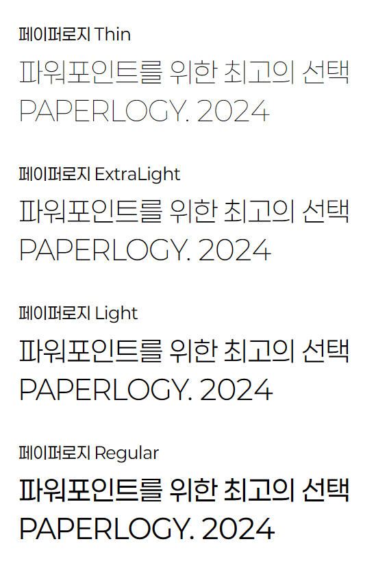

date-created:: [[2025-08-06]]
date-updated:: [[2026-07-11]] 
division:: [[design]] 
stack::
tags:: 
type::
public:: true

- ## Summary
	-
- ## Steps
	- ###  요구사항
		- 최우선은 가독성이다.
		- 효율적인 공간 활용을 위해 장평이 좁은 글꼴이어야 한다.
		- 제목용 글꼴
			- 두 개 이상의 굵기를 지원해야 한다.
			- 가벼워 보이지 않아야 한다.
		- 본문 글꼴
			- 두 개 이상의 굵기를 지원해야 한다.
	- ### List
		- #### Candidates
			- free
			  logseq.order-list-type:: number
				- [paperlogy](https://freesentation.blog/paperlogyfont)
				  logseq.order-list-type:: number
					- 영문 폰트의 개성이 뚜렸해 본문으로는 부적합하다.
					  logseq.order-list-type:: number
					- 
					  logseq.order-list-type:: number
			- paid
			  logseq.order-list-type:: number
				- [바람고딕](https://smartstore.naver.com/heummdesign/products/11205854710)
				  logseq.order-list-type:: number
- ## Troubleshooting
	-
- ## log
	- [[2025-08-06]] Page created.
- ### References
	- [오늘](https://onulfont.com) - a marketplace for indepedent typeface designers.
-