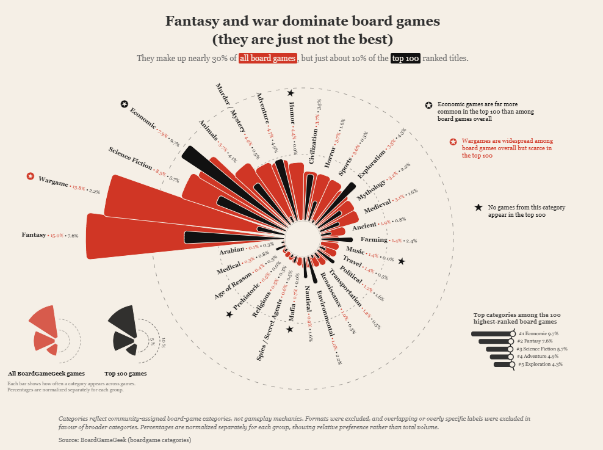

date-created:: [[2026-07-22]]
date-updated:: [[2026-07-22]]
alias::
tags:: #obsidianized 
ai-sourced:: 
division::
stack::
type::
public:: true

- ## Summary
	-
- ## Steps
	- ### works
		- [Radial hierarchical bar chart with grouping arcs](https://observablehq.com/d/33703039e1484511)
		  id:: 6a675fa3-051b-4ace-90e3-fb774962bb5a
			- {:width 350}
		- [No quiet at home: The reality of living with Singapore’s traffic noise | The Straits Times](https://www.straitstimes.com/multimedia/graphics/2025/12/singapore-traffic-noise/)
		- {{renderer :linkpreview,https://www.straitstimes.com/multimedia/graphics/2025/12/singapore-traffic-noise/}}
		- https://www.nytimes.com/interactive/2026/08/05/us/politics/trump-reflecting-pool-damage.html?unlocked_article_code=1.4lA.ps_X.RdxUeGzEzpxH&smid=url-share
			- The article equipped only the zoom and pan method to
		- [The Whiplash War](https://www.nytimes.com/interactive/2026/07/29/world/middleeast/iran-war-cease-fire-trump-timeline.html?unlocked_article_code=1.4lA.duwu.kVKvwMQ_0LwR&smid=url-share)
			- {:width 400}
	- ### studios
		- [Accurat Studio](https://studio.accurat.it/)
- ## Troubleshooting
	-
- ## log
	- [[2026-07-22]] Page created.